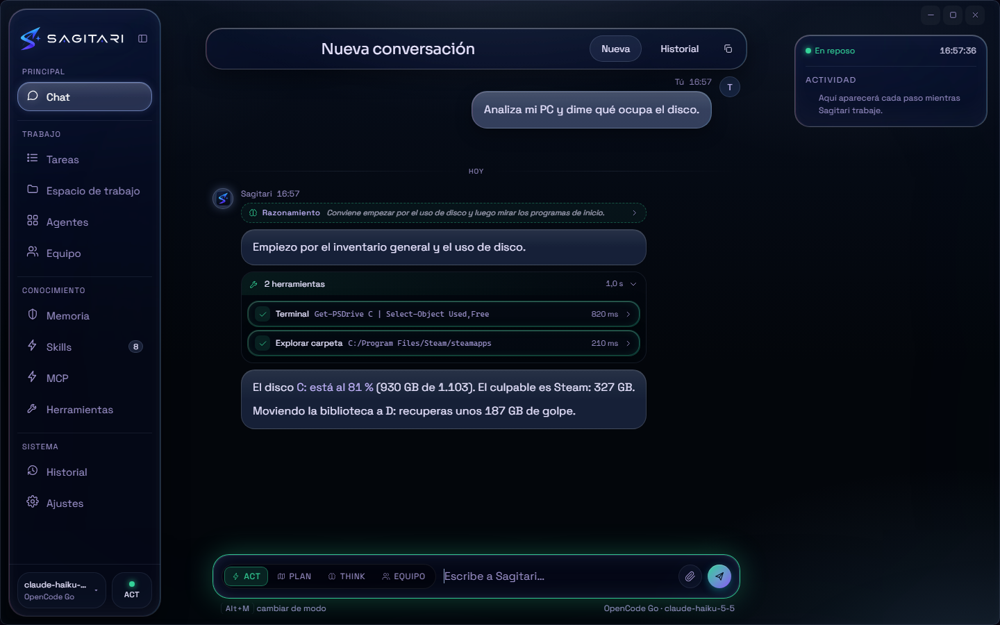
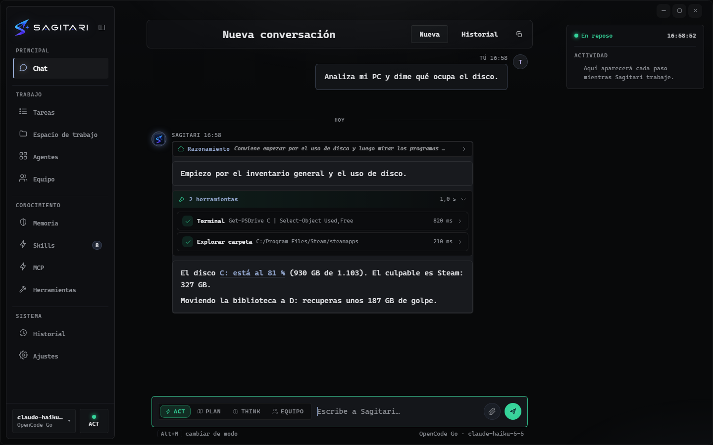
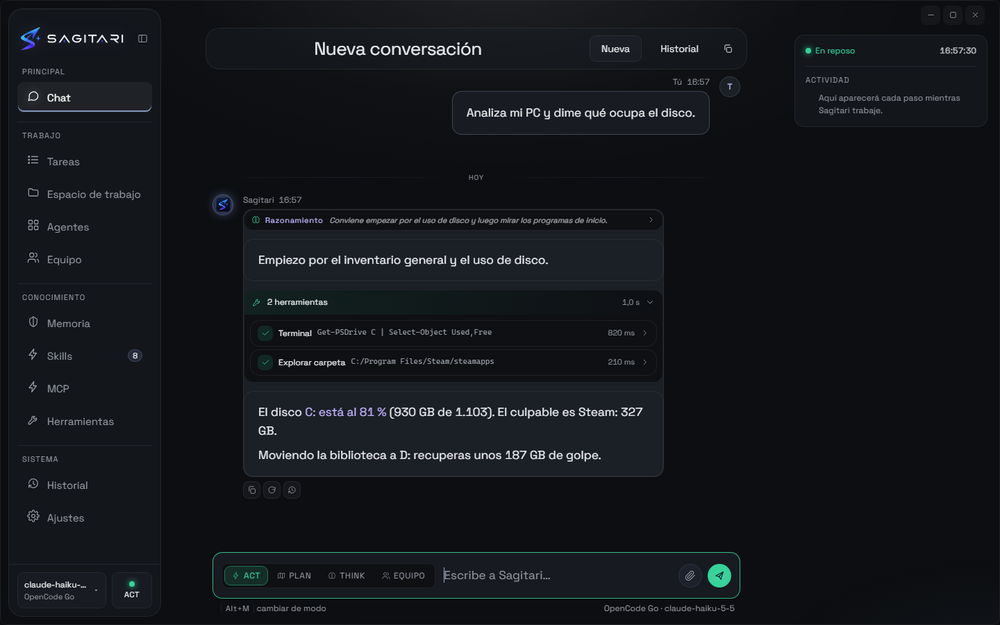

<div align="center">


# SAGITARI

### Tu agente de IA para escritorio — con manos.

**Pide en lenguaje natural. SAGITARI planea, ejecuta y te reporta en tu PC Windows.**

[](https://github.com/dario90vlc/sagitari/releases)
[](https://github.com/dario90vlc/sagitari/releases)
[](https://github.com/dario90vlc/sagitari/releases)
[](LICENSE)

[](https://github.com/dario90vlc/sagitari/releases/latest)

[Novedades](#novedades-de-esta-versión) · [Capturas](#se-ve-en-marcha) · [Aspectos](#aspectos) · [Por qué SAGITARI](#por-qué-sagitari) · [Qué puede hacer](#qué-puede-hacer) · [Seguridad](#seguridad-primero) · [Inicio rápido](#inicio-rápido) · [Descarga](#descarga) · [Privacidad](#privacidad) · [English](./README.md)

**Lenguaje natural dentro. Trabajo real fuera.** — SAGITARI usa tu terminal, tus archivos y tu navegador para terminar el trabajo, mientras la configuración, las claves, las conversaciones y la memoria se quedan en tu carpeta de datos. Su **memoria** es una ficha de hechos que **apruebas**, corriges y puedes vaciar.

</div>

---

## Se ve en marcha

<table>
  <tr>
    <td width="50%"></td>
    <td width="50%"></td>
  </tr>
  <tr>
    <td align="center"><sub><b>Chat</b> — planea, ejecuta y reporta</sub></td>
    <td align="center"><sub><b>Equipo</b> — un encargo repartido entre compañeros vivos, con su buzón y su tablero</sub></td>
  </tr>
  <tr>
    <td width="50%"></td>
    <td width="50%"></td>
  </tr>
  <tr>
    <td align="center"><sub><b>Memoria</b> — lo que sabe, y lo que espera tu visto bueno</sub></td>
    <td align="center"><sub><b>Apariencia</b> — aura, vidrio, a tu medida</sub></td>
  </tr>
  <tr>
    <td width="50%"></td>
    <td width="50%"></td>
  </tr>
  <tr>
    <td align="center"><sub><b>Agentes</b> — cada ejecución, en vivo</sub></td>
    <td align="center"><sub><b>Permisos</b> — nada sensible sin tu permiso</sub></td>
  </tr>
</table>

---

## ¿Por qué SAGITARI?

La mayoría de asistentes de IA de escritorio se quedan en el chat. SAGITARI está hecho para **terminar el trabajo**: puede usar tu terminal, trabajar con archivos, controlar Chrome o Edge, abrir aplicaciones, gestionar ventanas y mostrarte cada paso.

Es local-first por diseño. Tú eliges el modelo y el proveedor —en la nube o local— mientras la configuración, las API keys, las conversaciones, los logs, la memoria y los perfiles del navegador permanecen en tu equipo.

## Novedades de esta versión

- **La app habla español e inglés.** Sigue el idioma de Windows —cualquier variante del español cuenta— y Ajustes ▸ Apariencia ▸ Idioma lo puede forzar (Automático / Español / English). Se traducen menús, ajustes, tarjetas de herramientas, errores, tarjetas de permiso, diálogos nativos, bandeja y notificaciones; las respuestas del agente ya seguían el idioma en el que escribes.
- **El turno, en el orden en que ocurrió.** Al reabrir una conversación se repinta cada texto, cada bloque de razonamiento y cada tarjeta de herramienta en su sitio, no un muro de prosa con las herramientas aparte — y las respuestas largas se ven enteras, nunca cortadas.
- **Dos aspectos más.** Holo era el único; ahora le acompañan Consola y Lienzo, cada uno con su intensidad y su tinte, desde Ajustes ▸ Apariencia.
- **La tarjeta de permiso dice la verdad.** Un comando enseña la carpeta en la que se ejecuta; una herramienta MCP, sus argumentos. Deshacer ya no canta éxito cuando un archivo no se pudo restaurar, y no puede escribir fuera del espacio de trabajo.
- **Más difícil de engañar.** La lista de comandos prohibidos no se esquiva escribiéndolos de otra forma, `search_files` ya no puede congelar la app, la memoria deja de guardar hechos contradictorios y los adjuntos de texto cortos ya no se marcan como binarios.
- **Fontanería más pequeña y más segura.** `undici` 7.30.1, la salida de error de MCP enmascarada como el resto de secretos, y fechas, listas y el tablero ya sin restos de español donde no los esperabas.

## Aspectos

Tres aspectos: elíguelo en **Ajustes ▸ Apariencia** y la intensidad y el tinte le siguen. Holo es el de siempre; **Consola y Lienzo son nuevos en esta versión**.

| Holo | Consola | Lienzo |
| --- | --- | --- |
|  |  |  |

## Qué puede hacer

### Ejecuta.

Terminal, archivos, aplicaciones, ventanas y un navegador de verdad — una instrucción y el trabajo está hecho en tu PC.

<details>
<summary><b>Desglose completo</b></summary>

- **Terminal y archivos** — inspecciona, crea, edita y organiza tu espacio de trabajo.
- **Un equipo, cuando el trabajo se parte** — el cuarto modo (`Alt+M` llega a él) convierte al agente en **líder**: trocea tu orden y levanta hasta **4 compañeros** —los especialistas del registro, de serie o los que definas tú en disco— que trabajan **a la vez**, cada uno con su modelo y su propio permiso. Se pasan cosas por un buzón (a uno ocupado el mensaje le llega en su siguiente paso; a uno que terminó, se le despierta con él) y todos apuntan en un tablero compartido que puedes mirar. La vista **Equipo** enseña a cada compañero con su estado, el buzón y el tablero; el rail te dice quién está esperando un permiso. Un tope de presupuesto para al equipo y lo dice, en vez de seguir gastando.
- **Varias conversaciones a la vez** — un turno en marcha ya no bloquea la app: abre tantas conversaciones como quieras desde la tira de pestañas de la cabecera del chat, cada una con sus turnos, sus herramientas y su propia conversación con el modelo. La que sigue trabajando se marca como tal en su pestaña y en el Historial, y al volver la encuentras tal y como la dejaste. Cerrar una pestaña no borra la conversación.
- **Acciones de escritorio** — abre aplicaciones y URLs, gestiona ventanas, portapapeles, notificaciones y multimedia.
- **Navegador 2** — maneja Chrome o Edge como una persona: inventario con el **nombre accesible** de cada control (aunque sea un botón de icono), dentro de **componentes web e iframes**, clics que se vuelven a localizar por su huella y avisan si algo los tapa, esperas de verdad (`wait_for`), consola y errores de red (`logs`), diálogos, subida de archivos, atajos de teclado, listas y casillas, historial y descargas en una carpeta conocida.
- **Trabajo en paralelo** — las órdenes de un mismo mensaje se ejecutan a la vez con **bloqueo por recurso**: el navegador es uno solo, la escritura en disco va en cola y Detener mata todo lo que esté en vuelo.
- **Visión y adjuntos** — adjunta imágenes, código, documentos y ficheros de texto; las imágenes pueden enviarse a modelos con visión.
- **Lista de tareas viva, como los mejores agentes de código** — en una tarea de varios pasos el agente posee un checklist que actualiza mientras trabaja: marca cada paso en curso y completado, y tú lo ves avanzar en el chat. La lista viaja en su prompt en cada paso, así que el progreso sobrevive a los turnos largos y a los recortes de contexto, y se guarda con la conversación para que, al reabrirla, veas en qué quedó el trabajo.
- **Código con red** — sabe cómo se comprueban **tu** proyecto (tests, compilación, lint) y comprueba la **sintaxis** de cada archivo al escribirlo: el error vuelve al instante, no tres pasos después. `apply_patch` hace varias ediciones en varios archivos de una vez (o entran todas o no entra ninguna) y, antes de darte algo por hecho, un **agente de revisión** lee el cambio del turno y busca lo que está mal (contratos rotos, casos límite, restos del nombre viejo). Se apaga en Ajustes ▸ Delegación y verificación.
- **Mapa del proyecto** — en proyectos grandes indexa archivos y símbolos (`repo_map`, `find_symbol`) en vez de leerlos uno a uno, así no se pierde en100.000 líneas ni se queda en cuatro ediciones locales.
- **Leer la web sin navegador** — `web_fetch` trae una página y la reduce a texto (título, estado, cuerpo), así que consultar algo no cuesta una ventana de Chrome. Solo habla `http(s)`, sigue las redirecciones repitiendo la comprobación en cada salto y rechaza direcciones de bucle local, privadas, de enlace local y de metadatos: la barrera SSRF se aplica a la dirección resuelta, no al texto de la URL.
- **Git como herramienta, no como adivinanza** — `git_status`, `git_diff`, `git_log` y un `git_branch`/`git_commit` guardados dan al agente el estado del repositorio estructurado en vez de un muro de salida de terminal. Git se ejecuta con un array de argumentos y sin shell, siempre sobre tu espacio de trabajo, y las operaciones que reescriben historia (reset, push forzado, rebase, amend) no se exponen a propósito: esas siguen pasando por `run_command` y su confirmación.

</details>

### Piensa a tu manera.

Razona en profundidad, planifica antes de actuar o ve directo — con el modelo que tú elijas, en la nube o en local.

<details>
<summary><b>Desglose completo</b></summary>

- **En tu idioma** — la app entera habla español o inglés: sigue el idioma de Windows (cualquier variante del español es español) y Ajustes ▸ Apariencia ▸ Idioma lo puede forzar, aplicándose al reiniciar. Todo lo que SAGITARI te dice va en ese idioma —paneles, tarjetas de herramientas, errores, tarjetas de permiso, diálogos nativos, bandeja— mientras las respuestas del agente ya seguían el idioma en el que escribes.
- **Tu modelo, tus reglas** — OpenCode Go, OpenRouter, OpenAI, Anthropic, Groq, Google Gemini, DeepSeek, xAI (Grok), Mistral, Moonshot (Kimi), Cerebras, NVIDIA NIM, SambaNova o cualquier endpoint compatible, más los runtimes locales: Ollama, LM Studio, llama.cpp, vLLM, Jan, KoboldCpp, text-generation-webui y LocalAI. Cada preset trae el endpoint que documenta su fabricante, y el proveedor que guardes puede forzar su protocolo (compatible con OpenAI, con Anthropic o la API Responses) para que las pasarelas de terceros también funcionen.
- **Tus propios especialistas** — los siete subagentes de serie vienen con el producto, pero puedes definir los tuyos dejando un `AGENT.md` en `<carpeta de datos>/agents/<id>/` (nombre, descripción, herramientas permitidas, modelo, tope de pasos y su encargo). Una definición no puede darse más de lo que da el techo de serie: su lista de herramientas se cruza con el catálogo real. La vista de Agentes enseña el registro que la app usa de verdad, marcando cuáles vienen del disco, con un botón **Recargar** que los relee sin reiniciar.
- **Think / Plan / Act** — razona en profundidad, prepara un plan antes de actuar o ejecuta directamente. **PLAN es de verdad solo lectura**: el catálogo que se le ofrece al modelo se recorta a las herramientas de inspección y cualquier escritura se rechaza también al ejecutarla, así que el modo de planificación no puede tocar tu máquina.
- **Órdenes de barra** — `/` abre una paleta de órdenes por encima de tus skills: `/compact` hace que el modelo resuma el hilo para que una sesión larga siga, `/cost` dice los tokens y el gasto de esta conversación, `/clear` y `/new` empiezan de cero, `/model` cambia el modelo activo y `/help` las lista. Lo que no es una orden sigue siendo un mensaje.
- **Skills** — importa packs especializados `SKILL.md` y carga sus instrucciones bajo demanda; las de serie ya incluyen **oil-ui** (tres direcciones de diseño escritas, página comparativa de primeras pantallas y pulido con capturas reales).
- **Servidores MCP** — Conecta tus propios servidores MCP (comandos locales o URLs remotas) y el agente usa sus herramientas como las de casa. Todo lo que ejecutan pide permiso antes, y puedes dar más confianza a un servidor que conozcas.
- **Memoria y hábitos** — el agente guarda una ficha de hechos duraderos sobre ti y sobre cómo trabajas, y es tuya para auditarla: lo que aprende de un turno cae primero en la bandeja de aprobación, así que nada llega a ser un hecho sin tu visto bueno. Cada hecho dice de dónde salió y cuándo se usó por última vez, se edita en el sitio y pasa a una papelera recuperable cuando lo olvidas: los duplicados se fusionan, una corrección sustituye al dato viejo y lo que no usas baja de importancia antes de acabar en la papelera. Los hábitos (herramientas, aplicaciones, comandos, carpetas, webs, modos y permisos) se leen y se olvidan de uno en uno, y hay **Exportar mi memoria** y un olvídalo-todo de verdad. Vive en un fichero de tu carpeta de datos, y los recuerdos y hábitos que encajan con la conversación viajan al modelo que tengas configurado —igual que el resto del mensaje—, como dice la propia vista.
- **Fallback y recuperación** — cambio automático de modelo, tareas en segundo plano, checkpoints, pausa/reanudación y recuperación tras interrupciones. Si el proveedor acepta la conexión pero deja de enviar datos, el turno se corta solo (límite configurable en Ajustes › Seguridad) y el error se explica en el chat. El modelo elegido en Ajustes manda: el router no lo cambia por otro en silencio.

</details>

### Muestra el trabajo.

Cada paso, herramienta y segundo en pantalla.

<details>
<summary><b>Desglose completo</b></summary>

- Interfaz holográfica creada con HTML, CSS y JavaScript vanilla.
- **El turno, en orden** — un turno terminado se repinta tal como ocurrió: cada texto, cada bloque de razonamiento y cada tarjeta de herramienta en su sitio, no un muro de prosa con las herramientas aparte. Las respuestas largas se ven enteras.
- **Tres aspectos** — Holo (el de siempre) más Consola y Lienzo, cada uno con su intensidad y su tinte, desde Ajustes ▸ Apariencia.
- **La luz es la interfaz** — en vez de una banda alrededor de la ventana, el glow es el filo de 1px de las superficies que importan: el panel lateral cuando piensa, el compositor cuando trabaja, la tarjeta que está corriendo de verdad. Al cambiar de estado un reflejo recorre ese filo una vez y se posa; nada gira y nada late solo. El color y la intensidad siguen siendo tuyos.
- **Los cambios del turno, archivo a archivo** — antes de dar un turno por bueno, el panel de revisión enseña exactamente qué cambió: una tarjeta por archivo con sus `+añadidos / −borrados`, los hunks con sus números de línea y un botón para devolver **ese archivo solo** sin tocar el resto. Los que no se pueden restaurar por separado lo dicen en vez de aparentarlo.
- **Cuánto sitio queda** — el compositor lleva un medidor de contexto en vivo (holgado / ajustado / apretado) alimentado por la misma medición que usa el agente, así que ves llenarse una sesión larga antes de que empiece a recortar.
- **Duplicar y rebobinar** — duplica cualquier conversación desde el historial para probar otro camino sin perder la original, y rebobina un hilo hasta un mensaje anterior; el agente tira el resumen y la lista de tareas que describían lo que acabas de quitar.
- **Ajustes que se explican** — seis paneles (Modelo, Apariencia, Seguridad, Agente, Datos, Acerca de) con lo básico delante y lo avanzado plegado en sus propias tarjetas, cada una con una frase que dice qué hace y qué no hace. La lista de permisos cubre todas las herramientas del agente, no una muestra.
- Seis paletas de acento y controles de color e intensidad del glow en tiempo real.
- Conversaciones separadas, telemetría de agentes, logs locales estructurados y métricas opcionales para desarrolladores.
- **Razonamiento visible (opcional)**: los modelos que razonan (Claude, la serie o y GPT-5, DeepSeek R1…) enseñan su proceso en un bloque plegable sobre la respuesta; se lee en vivo mientras piensa y se pliega solo al empezar a contestar. Se activa en Ajustes ▸ Agente.

</details>

## Seguridad primero

SAGITARI tiene acceso real a tu ordenador, por eso la seguridad forma parte del producto:

- **Permisos por herramienta** — las acciones seguras pueden ejecutarse automáticamente; las sensibles piden confirmación.
- **Herramientas MCP** — pasan por el mismo motor de permisos: confirmación por defecto, niveles por servidor y por herramienta, y sus credenciales se guardan cifradas como tus claves de API.
- **Confirmación obligatoria** para operaciones sensibles del navegador, como leer el portapapeles, ejecutar JavaScript o cambiar de perfil.
- **Guardarraíles** para pasos, llamadas, duración, tokens, coste, bucles y tareas bloqueadas.
- **Parada real** — detener una ejecución también cancela el proceso asociado cuando es posible.
- **Subagentes limitados** — cada especialista solo recibe las herramientas permitidas.
- **Datos locales** — sin cuentas ni telemetría; las API keys se guardan con el almacén seguro de Windows cuando está disponible.
- **Actualizaciones verificadas** — las actualizaciones descargadas exigen el SHA-512 publicado y se vuelven a comprobar antes de instalarse.
- **Doble clic para lo sin firmar y las skills nuevas** — instalar una actualización sin firma digital, o importar skills de GitHub (órdenes que tu agente obedecerá), primero te enseña lo que viene y solo sigue cuando pulsas de nuevo.

## Inicio rápido

1. [Descarga SAGITARI](https://github.com/dario90vlc/sagitari/releases/latest) — instalador o portable en un solo `.exe`.
2. Abre **Ajustes** y elige un proveedor.
3. Introduce tu API key si es necesaria, detecta los modelos y activa uno.
4. Vuelve a **Chat** y pide algo real.

Atajos útiles:

| Atajo          | Acción                              |
| -------------- | ----------------------------------- |
| `Alt+1…9`      | Cambiar de sección                  |
| `Ctrl+Alt+S`   | Mostrar u ocultar el panel          |
| `Alt+Shift+S`  | Traer SAGITARI al frente            |
| `Ctrl+Shift+G` | Lanzar un pulso de glow             |
| `Alt+M`        | Ciclar ACT → PLAN → THINK → EQUIPO |
| `/` en el chat | Abrir la paleta de órdenes y skills |

## Descarga

| Paquete                                                                                         | Descripción                                                                |
| ----------------------------------------------------------------------------------------------- | -------------------------------------------------------------------------- |
| [**⬇ Descargar SAGITARI para Windows**](https://github.com/dario90vlc/sagitari/releases/latest) | Instalador (accesos directos + desinstalador) y portable en un solo `.exe` |
| [**Notas de la versión**](https://github.com/dario90vlc/sagitari/releases)                      | Cambios, correcciones de seguridad y hashes SHA-256                        |

> **Windows SmartScreen:** los binarios no tienen firma digital actualmente, por lo que Windows puede mostrar un aviso la primera vez. Pulsa _Más información → Ejecutar de todas formas_ si confías en la descarga. Comprueba el hash SHA-256 publicado en las notas de la release.

## Privacidad

- La configuración, las API keys, conversaciones, logs, memoria y perfiles del navegador se guardan en `%APPDATA%\SagitariAI\`.
- Las claves van directamente desde la aplicación local al proveedor elegido.
- Con proveedores locales como Ollama puedes trabajar sin enviar datos a la nube.
- El renderer usa `contextIsolation`, desactiva la integración Node y se ejecuta en sandbox.

<details>
<summary><b>Estructura del proyecto</b></summary>

```text
sagitari/
├── main/           Proceso principal de Electron, ventanas, IPC y proveedores
├── agent/          Loop del agente, herramientas, seguridad, memoria, skills y navegador
├── renderer/       Interfaz HTML/CSS/JS vanilla
├── skills-starter/ Skills iniciales incluidas
├── scripts/        Diagnósticos, comprobaciones de UI y herramientas de assets
└── docs/           Capturas y recursos gráficos
```

</details>

## Licencia

SAGITARI es gratuito para uso personal — gratis para siempre, sin cargos.
Su código fuente se puede revisar, pero no compilar, distribuir, replicar ni
usar desde empresas; el nombre y el logotipo SAGITARI son marca de su autor.
Términos completos en la [Licencia de Uso Personal de SAGITARI](LICENSE).

<div align="center">

**Para quien quiere un asistente que haga algo más que hablar.**

[⬆ Volver arriba](#sagitari)

</div>
