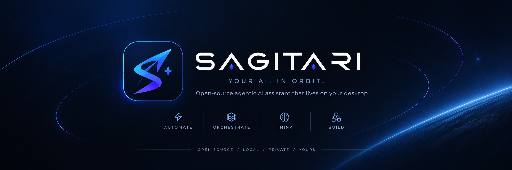
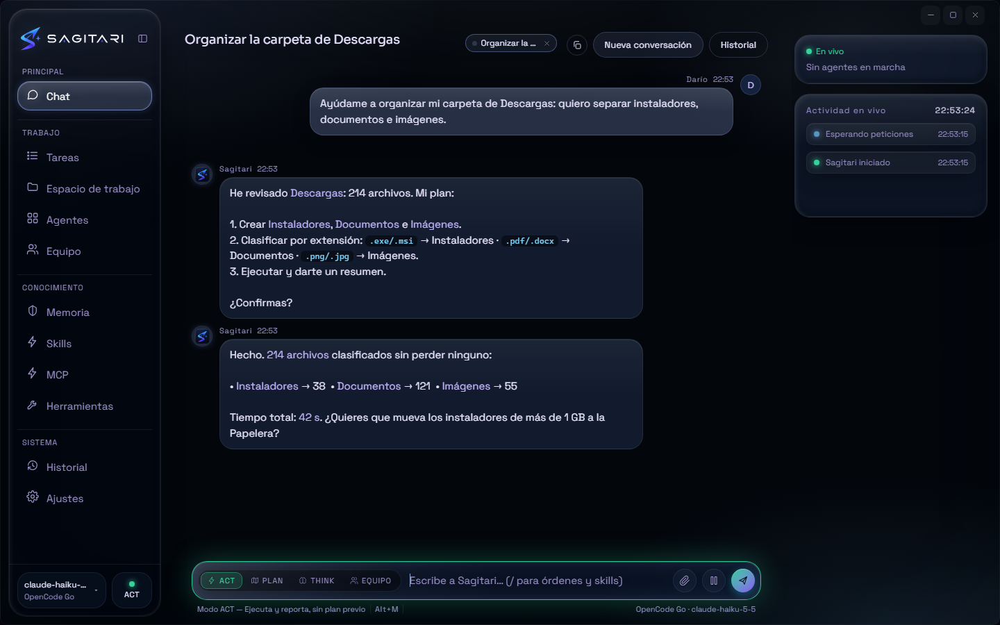
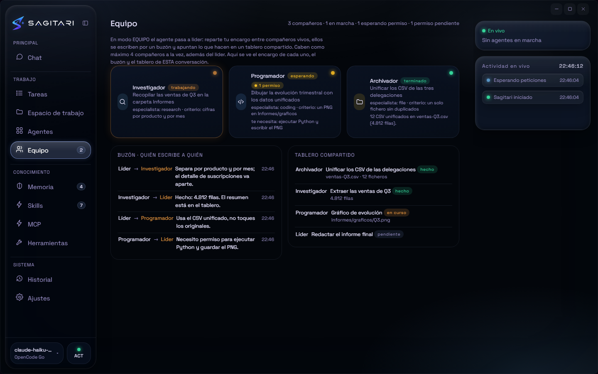
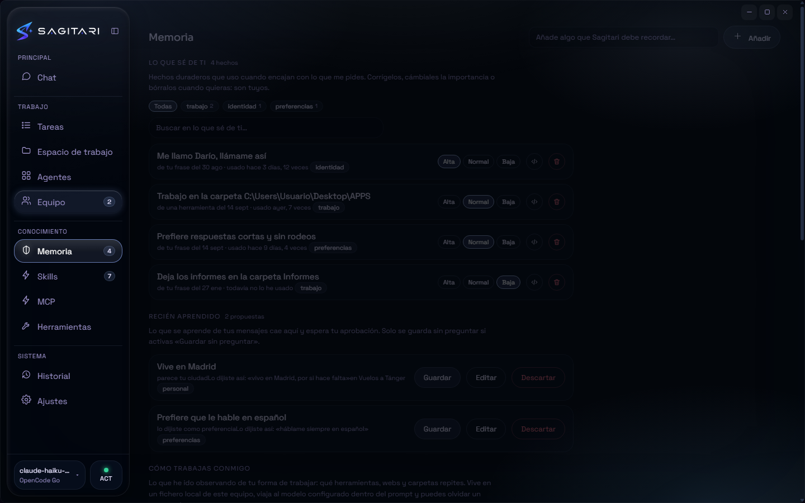
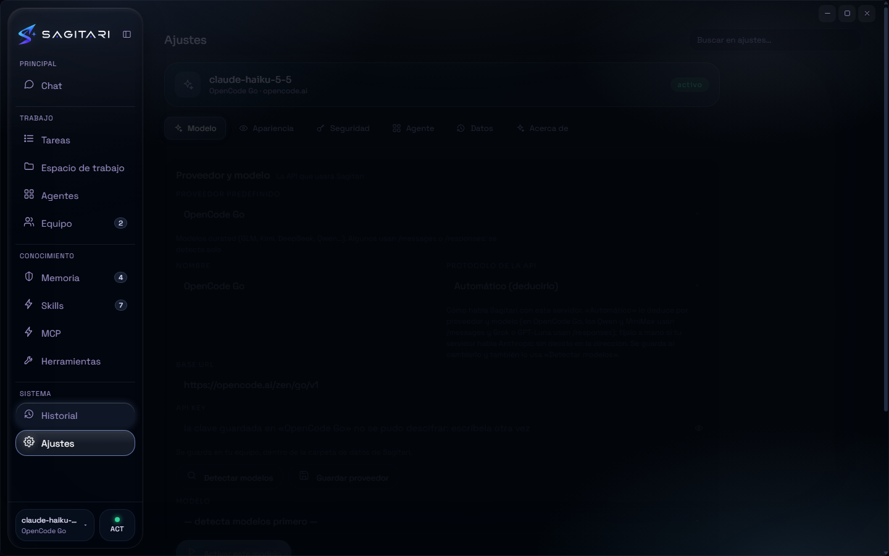
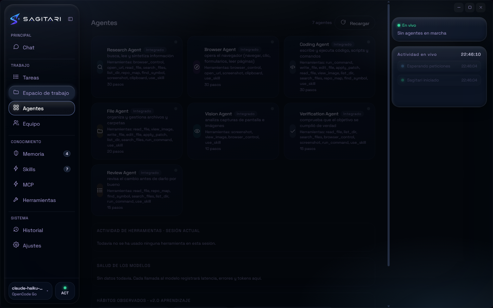
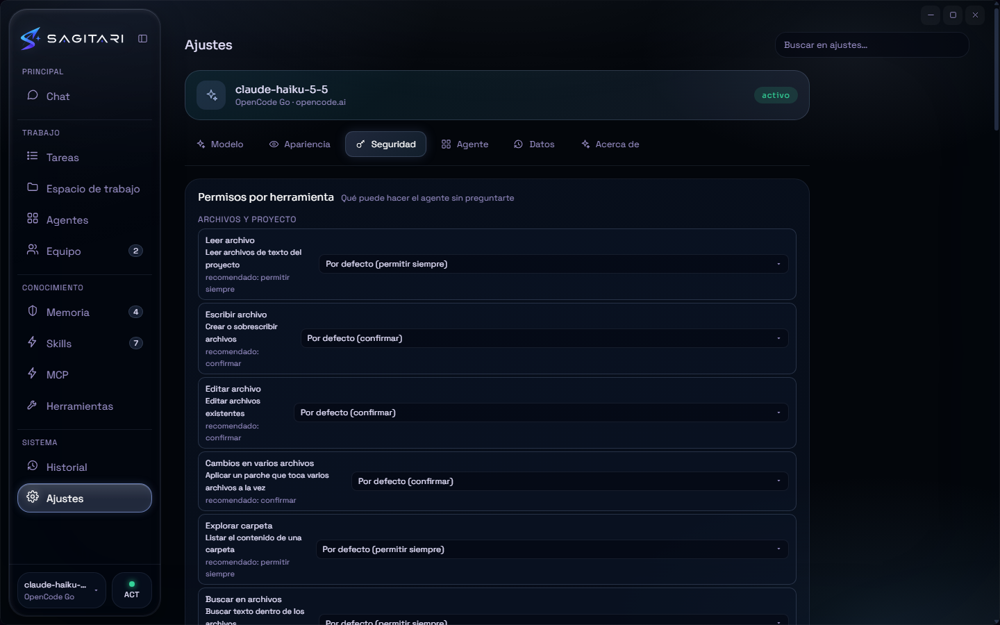

<div align="center">



# SAGITARI

### Your desktop AI agent — with hands.

**Ask in natural language. SAGITARI plans, acts, and reports back on your Windows PC.**

[](https://github.com/dario90vlc/sagitari/releases)
[](https://github.com/dario90vlc/sagitari/releases)
[](https://github.com/dario90vlc/sagitari/releases)
[](LICENSE)

[](https://github.com/dario90vlc/sagitari/releases/latest)

[Download](#download) · [Features](#what-it-does) · [Security](#safety-first) · [Español](./README.es.md)

**Natural language in. Real work out.** — SAGITARI uses your terminal, your files, and your browser to finish the job, while config, keys, conversations and memory stay in your data folder. Its **memory** is a card file of facts **you approve**, correct and can empty.

</div>

---

## See it work

<table>
  <tr>
    <td width="50%"></td>
    <td width="50%"></td>
  </tr>
  <tr>
    <td align="center"><sub><b>Chat</b> — plans, runs, and reports back</sub></td>
    <td align="center"><sub><b>Team</b> — one order split between live teammates, with their mailbox and board</sub></td>
  </tr>
  <tr>
    <td width="50%"></td>
    <td width="50%"></td>
  </tr>
  <tr>
    <td align="center"><sub><b>Memory</b> — what it knows, and what waits for your OK</sub></td>
    <td align="center"><sub><b>Appearance</b> — aura, glass, yours to tune</sub></td>
  </tr>
  <tr>
    <td width="50%"></td>
    <td width="50%"></td>
  </tr>
  <tr>
    <td align="center"><sub><b>Agents</b> — every run, live</sub></td>
    <td align="center"><sub><b>Permissions</b> — nothing sensitive without your OK</sub></td>
  </tr>
</table>

---

## Why SAGITARI?

Most desktop AI assistants stop at the chat box. SAGITARI is built to **finish the job**: it can use your terminal, work with files, drive Chrome or Edge, open apps, manage windows, and keep you informed at every step.

It is local-first by design. You choose the model and provider — cloud or local — while configuration, API keys, conversations, logs, memory, and browser profiles stay on your machine.

## What's new in this release

- **The app speaks English and Spanish.** It follows the Windows language — every Spanish variant counts — and Settings ▸ Appearance ▸ Language overrides it (Automatic / Español / English). Menus, settings, tool cards, errors, permission prompts, native dialogs, the tray and notifications are translated; the agent's answers already followed the language you write in.
- **The turn, in the order it happened.** Reopening a conversation repaints each text, each reasoning block and each tool card where it belongs, instead of a wall of prose with the tools folded away — and long answers are shown whole, never cut.
- **Two more looks.** Holo was the only one; now Console and Canvas sit next to it, each with its own intensity and tint, from Settings ▸ Appearance.
- **The permission card tells the truth.** A command shows the folder it will run in; an MCP tool shows its arguments. Undo no longer claims success when a file could not be restored, and it cannot write outside the workspace.
- **Harder to fool.** The prohibited-command list can't be dodged by spelling the same command another way, `search_files` can no longer freeze the app, memory stops keeping contradictory facts, and short text attachments are no longer labelled binary.
- **Smaller, safer plumbing.** `undici` 7.30.1, MCP error output masked like every other secret, and a space that no longer carries Spanish in places you would not expect (dates, lists, the task board).

## What it does

### It executes.

Terminal, files, apps, windows, and a real browser — one instruction, and the work is done on your PC.

<details>
<summary><b>Full breakdown</b></summary>

- **Terminal and files** — inspect, create, edit, and organize work in your filesystem.
- **A team, when the job splits** — the fourth mode (`Alt+M` reaches it) turns the agent into a **leader**: it breaks your order down and lifts up to **4 teammates** — the registry's specialists, built-in or ones you define on disk — who work **at the same time**, each with its own model and its own permission prompt. They hand each other things through a mailbox (a busy teammate gets the message on its next step; a finished one wakes up with it) and everyone writes to a shared board you can watch. The **Equipo** view shows every teammate with its state, the mailbox and the board; the rail tells you which teammate is waiting for a permission. A budget cap stops the team and says so rather than burning through your tokens.
- **Several conversations at once** — a running turn no longer locks the app: open as many conversations as you want from the tab strip in the chat header, each with its own turns, its own tools and its own model exchange. A conversation that is still working is marked as such in its tab and in the History list, and switching back restores it exactly as you left it. Closing a tab does not delete the conversation.
- **Desktop actions** — open applications and URLs, manage windows, clipboard, notifications, and multimedia.
- **Browser v2** — drives Chrome or Edge like a person: an inventory with each control's **accessible name** (even icon-only buttons), inside **web components and iframes**, clicks re-located by fingerprint that warn when something covers them, real waits (`wait_for`), console and network errors (`logs`), dialogs, file uploads, keyboard shortcuts, lists and checkboxes, history, and downloads into a known folder.
- **Parallel work** — orders in the same message run at once behind **per-resource locks**: there is only one browser, disk writes queue up, and Stop kills everything in flight.
- **A live task list, like the best coding agents** — on a multi-step task the agent owns a checklist it updates as it goes: it marks each step in progress and completed, and you watch it advance in the chat. The list travels in its prompt on every step, so progress survives long turns and context trimming, and it is saved with the conversation so you can see where the work ended when you reopen it.
- **Code with a safety net** — it knows how **your** project is verified (tests, build, lint) and syntax-checks every file as it writes it, so the error comes back right away instead of three steps later. `apply_patch` makes several edits across several files at once (all of them or none) and, before handing you anything as done, a **review agent** reads the turn's diff looking for what's wrong (broken contracts, missed edge cases, leftovers of the old name). Turn it off in Settings ▸ Delegation and verification.
- **Project map** — on large projects it indexes files and symbols (`repo_map`, `find_symbol`) instead of reading them one by one, so it doesn't get lost in 100,000 lines or settle for four local edits.
- **Read the web without a browser** — `web_fetch` pulls a page and reduces it to text (title, status, body), so looking something up doesn't cost a Chrome window. It only speaks `http(s)`, follows redirects with the check re-run at every hop, and refuses loopback, private, link-local and metadata addresses — the SSRF rule is enforced on the resolved address, not on the text of the URL.
- **Git as a tool, not a guess** — `git_status`, `git_diff`, `git_log` and a guarded `git_branch`/`git_commit` give the agent structured repository state instead of a wall of terminal output. Git runs through an argument array with no shell, always on your workspace, and history-rewriting operations (reset, force-push, rebase, amend) are deliberately not exposed: those still go through `run_command` and its permission prompt.

</details>

### It thinks your way.

Reason deeply, plan before acting, or go direct — with the model of your choice, cloud or local.

<details>
<summary><b>Full breakdown</b></summary>

- **In your language** — the whole app speaks Spanish or English: it follows the Windows language (any Spanish variant is Spanish) and Settings ▸ Appearance ▸ Language overrides it, applied on restart. Everything SAGITARI says to you is in that language — panels, tool cards, errors, permission prompts, native dialogs, the tray — while the agent's answers already followed the language you write in.
- **Bring your own model** — OpenCode Go, OpenRouter, OpenAI, Anthropic, Groq, Google Gemini, DeepSeek, xAI (Grok), Mistral, Moonshot (Kimi), Cerebras, NVIDIA NIM, SambaNova, or any compatible endpoint — plus local runtimes: Ollama, LM Studio, llama.cpp, vLLM, Jan, KoboldCpp, text-generation-webui and LocalAI. Every preset carries the endpoint its vendor documents, and the provider you save can force its API protocol (OpenAI-compatible, Anthropic-compatible or the Responses API) so third-party gateways work too.
- **Your own specialists** — the seven built-in subagents live in the product, but you can define your own by dropping an `AGENT.md` into `<data dir>/agents/<id>/` (name, description, allowed tools, model, step budget and its brief). A definition can never grant itself more than the built-in ceiling: its tool list is intersected with the real catalogue. The Agents view shows the registry the app actually uses, marked so you can see which agents came from disk, with a **Recargar** button that re-reads them without restarting.
- **Think / Plan / Act** — reason deeply, prepare a plan before acting, or execute directly. **PLAN is genuinely read-only**: the tool set offered to the model is cut to inspection tools and any write is refused at execution time too, so the planning mode cannot touch your machine.
- **Slash commands** — `/` opens a palette of commands above your skills: `/compact` has the model summarize the thread so a long session keeps going, `/cost` reports this conversation's tokens and spend, `/clear` and `/new` start over, `/model` switches the active model and `/help` lists them. What isn't a command is still just a message.
- **Skills** — import specialized `SKILL.md` packs and load their instructions on demand instead of bloating every prompt; the bundled set now includes **oil-ui** (three written design directions, a side-by-side first-screen comparison page and screenshot-driven polish).
- **MCP servers** — Connect your own MCP servers (local commands or remote URLs) and the agent uses their tools like built-in ones. Everything they run asks for permission first, and you can promote a server you trust.
- **Memory and habits** — the agent keeps a card file of durable facts about you and the way you work, and it is yours to audit: what it learns from a turn lands in an approval tray first, so nothing becomes a fact until you say so. Every fact shows where it came from and when it was last used, is edited in place, and moves to a recoverable trash when you forget it — duplicates merge, a correction replaces the old fact, and what goes unused fades to low importance before it ever reaches the trash. Habits (tools, apps, commands, folders, sites, modes, permissions) are readable and forgettable one category at a time, and there is an **Export my memory** and a real forget-it-all. It lives in a file inside your data folder, and the facts and habits that match the conversation travel to the model you configured — like the rest of the message — as the view itself spells out.
- **Fallbacks and recovery** — model fallback, background tasks, checkpoints, pause/resume, and recovery after interruptions. If a provider accepts the connection but stops sending data, the turn cuts itself off (configurable limit in Settings › Security) and the error is explained in the chat. The model chosen in Settings wins: the router no longer swaps it silently.

</details>

### It shows the work.

Every step, tool, and second on screen.

<details>
<summary><b>Full breakdown</b></summary>

- Holographic interface built with vanilla HTML, CSS, and JavaScript.
- **The turn, in order** — a finished turn is repainted the way it happened: each text, each reasoning block and each tool card in its place, not a wall of prose with the tools folded away. Long answers are always shown whole.
- **Three looks** — Holo (the original) plus Console and Canvas, each with its own intensity and tint, chosen in Settings ▸ Appearance.
- **The light is the interface** — instead of a band around the window, the glow is the 1px edge of the surfaces that matter: the sidebar when it thinks, the composer when it works, the card that is actually running. State changes send one highlight along that edge and it settles; nothing spins and nothing pulses on its own. Colour and intensity are still yours.
- **The turn's changes, per file** — before you accept a turn as done, the review panel shows exactly what changed: one card per file with its `+adds / −dels`, the hunks with line numbers, and a button to put back **that one file** without touching the rest. Files that can't be restored on their own say so instead of pretending.
- **How much room is left** — the composer carries a live context meter (normal / tight / critical) fed by the same measurement the agent uses, so you can see a long session filling up before it starts trimming.
- **Duplicate and rewind** — duplicate any conversation from the history to try another path without losing the original, and rewind a thread to an earlier message; the agent drops the summary and task list that described what you just removed.
- Reactive light while the agent thinks or works — on the surface that is doing the work, not around the window.
- **Settings that explain themselves** — six panels (Model, Appearance, Security, Agent, Data, About) with the basics first and the advanced controls folded into their own cards, each with a sentence saying what it does and what it does not. The permissions list covers every tool the agent has, not a sample.
- Separate conversations, live agent telemetry, structured local run logs, and optional developer metrics.
- **Visible reasoning (optional)**: reasoning models (Claude, the o-series and GPT-5, DeepSeek R1…) show their thinking in a collapsible block above the answer; it streams live while they think and folds itself as soon as they start answering. Turn it on in Settings ▸ Agent.

</details>

## Safety first

SAGITARI gives an agent real access to your computer, so safety is part of the product:

- **Permission levels per tool** — safe actions can run automatically; sensitive actions ask first.
- **MCP tools** — follow the same permission engine: confirmation by default, per-server and per-tool levels, and their credentials are stored encrypted like your API keys.
- **Mandatory confirmation for sensitive browser operations** such as clipboard access, page JavaScript, and profile changes.
- **Guardrails** for steps, tool calls, duration, tokens, cost, loops, and stalled work.
- **Real stop control** — stopping a run also cancels the process behind it where possible.
- **Restricted subagents** — each specialist receives only the tools it is allowed to use.
- **Local data** — no account and no telemetry; API keys are stored using the Windows system keystore when available.
- **Verified updates** — downloaded updates require the published SHA-512 and are checked again before installation.
- **Two-click consent for unsigned updates and new skills** — installing an update without a digital signature, or importing skills from GitHub (instructions your agent will obey), shows you what is coming first and only proceeds when you click again.

## Quick start

1. [Download SAGITARI](https://github.com/dario90vlc/sagitari/releases/latest) — installer or portable single `.exe`.
2. Open **Settings** and choose a provider preset.
3. Enter your API key if that provider needs one, detect models, and activate a model.
4. Return to **Chat** and ask for something real.

Useful shortcuts:

| Shortcut       | Action                               |
| -------------- | ------------------------------------ |
| `Alt+1…9`      | Switch sections                      |
| `Ctrl+Alt+S`   | Show or hide the panel               |
| `Alt+Shift+S`  | Bring SAGITARI to the front          |
| `Ctrl+Shift+G` | Trigger a glow pulse                 |
| `Alt+M`        | Cycle ACT → PLAN → THINK → EQUIPO    |
| `/` in chat    | Open the commands and skills palette |

## Download

| Package                                                                                       | Description                                                    |
| --------------------------------------------------------------------------------------------- | -------------------------------------------------------------- |
| [**⬇ Download SAGITARI for Windows**](https://github.com/dario90vlc/sagitari/releases/latest) | Installer (shortcuts + uninstaller) and portable single `.exe` |
| [**Release notes**](https://github.com/dario90vlc/sagitari/releases)                          | Changes, security fixes, and SHA-256 hashes                    |

> **Windows SmartScreen:** the binaries are currently unsigned, so Windows may show a warning on the first run. Choose _More info → Run anyway_ if you trust the download. Verify the SHA-256 hash published in the release notes.

## Privacy

- Configuration, API keys, conversations, logs, memory, and browser profiles live under `%APPDATA%\SagitariAI\`.
- Provider keys go directly from your local app to your selected provider.
- Local providers such as Ollama can run without sending data to a cloud service.
- The renderer uses `contextIsolation`, disables Node integration, and runs sandboxed.

<details>
<summary><b>Project structure</b></summary>

```text
sagitari/
├── main/           Electron main process, windows, IPC, providers
├── agent/          Agent loop, tools, guardrails, memory, skills, tasks, browser
├── renderer/       Vanilla HTML/CSS/JS interface
├── skills-starter/ Bundled starter skills
├── scripts/        Diagnostics, UI checks, and asset tools
└── docs/           Screenshots and project artwork
```

</details>

## Development

### Scripts

| Script                  | Description                          |
| ----------------------- | ------------------------------------ |
| `npm start`             | Start the app in production          |
| `npm run dev`           | Start the app in development mode    |
| `npm run smoke`         | Run smoke test                       |
| `npm test`              | Run the agent/main suite (513 tests) |
| `npm run test:renderer` | Run the renderer suite (842 tests)   |
| `npm run lint`          | Run ESLint                           |
| `npm run lint:fix`      | Run ESLint with auto-fix             |
| `npm run format`        | Format with Prettier                 |
| `npm run format:check`  | Check formatting with Prettier       |
| `npm run uicheck`       | Check the live interface (CDP)       |
| `npm run shots`         | Capture every view to `shots/`       |
| `npm run contraste`     | Audit palette contrast (WCAG AA)     |

### Tests

Two suites, both green before every release:

```bash
npm test              # 513 tests: the agent core and the main process
npm run test:renderer # 842 tests across 51 files: main-process modules and the renderer
```

`npm test` (`test/run.js`) covers the agent loop end to end: guardrails,
commands, memory, hooks, skills, models, subagents, context budget, diffs,
diagnostics, search, repo map, project detection, habits, checkpoints, MCP
transport/config, execution utilities, run-log redaction, the todo list, the
close-verification gate — plus the main process (update versions/assets/signature,
provider presets, attachments) and the renderer (chatkit, protocols, tools,
config, history).

`test/renderer/run.js` discovers every `*.test.js` in the folder and runs them in
a single process — no child process is spawned, so it works under a restricted
sandbox. Adding a new test file needs no config change.

### Verifying the interface

Two checks cover what unit tests cannot see — the pixels and the contrast:

```bash
npm run uicheck     # arranca la app y comprueba iconos, cableado, navegación y temas
npm run shots       # captura las 13 vistas a shots/<vista>.png por CDP
npm run contraste   # mide el contraste de cada color de texto contra cada superficie (también rótulos con opacidad o de pseudo-elemento)
```

`shots` accepts a view list and a size, and `--demo` seeds a real conversation
drawn with the renderer's own `bubble()` so `chat.png` shows the interface
rather than the empty state. Besides the eleven sections it captures two UI states
built with the renderer's own painters — `slash.png` (the `/` palette with its
commands) and `diffs.png` (the turn's change review panel):

```bash
npm run shots                                  # las 13 vistas, con demo
node scripts/shot-cdp.js shots chat 1440 900   # solo el chat, sin demo
node scripts/shot-cdp.js shots slash,diffs     # las dos capturas de estado
```

`uicheck` drives the real window over the Chromium debugging protocol: it fails if a
renderer script breaks, if an icon is undrawn, or if a view stops responding.

`shots` needs a runnable Electron. In a sandbox where the binary exits with
`STATUS_CONTROL_C_EXIT`, launch it with `--no-sandbox --disable-gpu` and make sure
`ELECTRON_RUN_AS_NODE` is not set — with that variable Electron behaves as plain
Node, `app` does not exist and no window ever opens. `scripts/lanzar.js` does all
three and is what `npm run smoke` calls; it also points the data profile at
`.perfil-pruebas/` inside the workspace, because a restricted token cannot write
to `%APPDATA%` and the single-instance lock is never created (the app then exits
with «SAGITARI ya está abierta» when nothing is open). `main/main.js` honours
`SAGITARI_TEST_PROFILE` for the same reason, and `uicheck`/`shot-cdp` set it too.

`npm test` needs the same help for a different write: the isolated git worktree each
subagent gets (`agent/arboles.js`). The suite points `SAGITARI_ARBOLES_DIR` at
`.tmp-arboles/` inside the workspace — a restricted token cannot create a worktree under
`%TEMP%` — and deletes it when it finishes. Set the variable to keep them elsewhere; in
production the default is `%TEMP%/sagitari-arboles`. That base directory never moves the
workspace: inside the tree the subagent works in the same relative path it has in the
repository, and its work is merged back into the user's folder even when the same path is
spelled in more than one way (a Windows 8.3 short name, a link, an MSYS path). That merge
also carries what the subagent writes inside a path the project has in `.gitignore`, which
the plain `git add` never saw: the file used to be dropped while the fusion reported «no
changes». `uicheck` does the same (`.tmp-arboles/uicheck/`) and fails if the teammate it
drives did not really work in an isolated tree.

`contraste` reads the tokens from `renderer/styles.css`, composites each
translucent surface over the base background, and reports every text/surface pair
below 4.5:1 (WCAG 2.1 AA for body text). It also measures the composed texts the
token sweep cannot see: labels painted with an `opacity` (the effective colour is
the mix with the background) and labels drawn by a `::before`/`::after` with
`content`, each one against its worst surface. It reads the tokens and the rules,
so a palette or label change is audited by re-running it.

The gallery at the top of this README is regenerated with `npm run shots` — the
committed PNGs lag behind the CSS, so treat them as the design language rather
than the current pixel state.

### Linting and formatting

ESLint 9 + Prettier are configured across the project:

```bash
npm run lint
npm run format
```

## License

SAGITARI is free for personal use —100% free, forever, with no fees ever.
Its source code may be reviewed, but it may not be compiled, redistributed,
replicated or used by companies, and the SAGITARI name and logo are
trademarks of its author. Full terms in the
[SAGITARI Personal Use License](LICENSE).

<div align="center">

**Built for people who want an assistant that does more than talk.**

[⬆ Back to top](#sagitari)

</div>
